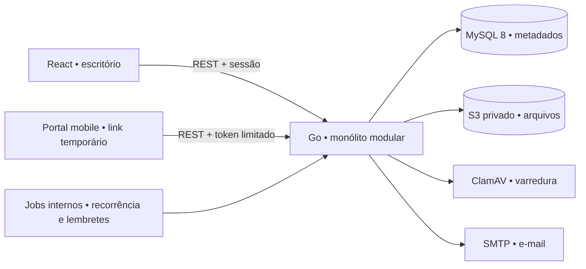

# Arquitetura e modelo de dados

Este documento define a arquitetura pretendida e as regras de domínio. Existência de uma tabela ou componente não prova que seu fluxo esteja concluído; veja o checklist de piloto e as validações executadas no README.

## Decisões

**Monólito modular Go** com API REST, jobs no mesmo processo e MySQL 8. Um frontend React/TypeScript, servido por Vite no desenvolvimento, consome a API com cookie de sessão. TanStack Query mantém dados remotos; React Hook Form e Zod tratam formulários. EasyUI instalado pelo registry oficial do shadcn fornece componentes adaptados ao design system. Não há microserviços, Redis, fila externa nem estado global genérico.

- `apps/web`: UI, layouts, páginas/fluxos, cliente HTTP, schemas, estilos e tokens.
- `apps/api`: auth, organizações, clientes, modelos, solicitações, documentos, recorrência e comunicações, com regras validadas no servidor.
- `infra`: execução local e imagens auxiliares. Compose inclui API, MySQL, MinIO, Mailpit e ClamAV.
- `docs`: produto, contratos, decisões e critérios de aceite.

**Duas configurações explícitas:** `STORE_DRIVER=mysql` é o caminho de produção; `STORE_DRIVER=json` e arquivos privados locais existem somente para desenvolvimento sem Docker. Falha de MySQL não pode ativar JSON automaticamente. JSON não é validação de transações, concorrência SQL ou isolamento do banco em produção.

**Arquivos fora do MySQL:** o banco guarda chave opaca, hash, tamanho, MIME, versão e resultado de varredura; os bytes ficam no storage privado. API autoriza o acesso antes de transmitir conteúdo ou emitir URL curta. Não retornar credenciais do bucket nem tornar objetos públicos. O cliente não escolhe caminho físico. Upload não verificado não pode ser apresentado como limpo.

**Comunicação verdadeira:** `accepted` significa aceito pelo SMTP/provedor; `delivered` exige evento próprio do provedor, indisponível em SMTP simples. Abrir WhatsApp é `manual_opened`, sem confirmação de envio. Rejeição/indisponibilidade fica visível e permite repetir com deduplicação.

**Tempo:** persistir instantes em UTC; competência é `YYYY-MM`, prazo é data civil, recorrência usa `America/Sao_Paulo`. Não somar 30 dias para avançar um mês. Dia 31 em fevereiro executa no último dia; competência anterior de janeiro é dezembro do ano anterior.

## Modelo relacional de referência

IDs opacos; horários de criação/alteração em UTC. Toda tabela do escritório tem `organization_id`, inclusive as tabelas filhas, com consultas e vínculos limitados ao mesmo escritório. Tabelas de sessão e recuperação complementam as entidades de negócio.

| Entidade | Campos e relações principais | Invariantes/índices |
|---|---|---|
| organizations | nome, timezone, plano, limites, retenção, preferências de comunicação | timezone inicial São Paulo; limites aplicados na API |
| users | e-mail normalizado, password_hash Argon2id | e-mail único; hash nunca retornado |
| organization_members | organização, usuário, papel owner/member | unique(org,user); membro ativo para toda rota interna |
| sessions | user, organization, token_hash, expires_at, revoked_at | índice token_hash; expiração aplicada em consulta |
| password_reset_tokens | user, token_hash, expires_at, used_at | uso único; respostas sem revelar cadastro |
| clients | organização, nome, tax_id, responsável, e-mail, telefone, archived_at | índice(org,nome), índice(org,tax_id); arquivar preserva histórico |
| document_templates | organização, nome, versão, archived_at | editar não altera cópias históricas |
| document_template_items | organização, modelo, nome, instrução, required, max_files, position | FK composta com org; ordem explícita |
| document_requests | organização, cliente, competência, prazo, status, schedule_id, completed_at | índices(org,status,prazo), (org,cliente,competência); unique(schedule,cliente,competência) para recorrentes |
| document_request_items | organização, solicitação, snapshot do item/modelo, status, motivo da correção | índice(org,request,position); obrigatório aprovado para concluir |
| document_files | organização, item, object_key, original_name, mime, size, sha256, scan_status, replaced_by, reviewed_by/at | objeto privado; versões preservadas; hash+item para deduplicar |
| recurring_schedules | organização, modelo, dia, prazo relativo, competência relativa, timezone, active | dias 1–31; pausar não apaga histórico |
| recurring_schedule_clients | organização, recorrência, cliente | unique(schedule,client); apenas clientes da organização |
| recurring_runs | organização, regra, competência, started_at, result, error_code | unique(schedule,competência); histórico de tentativas sem dados pessoais |
| notification_deliveries | organização, request, canal, tipo, dedupe_key, attempt, status, provider_id, accepted_at, error_code | unique(dedupe_key,attempt); não enviar após conclusão |
| public_access_tokens | organização, request, token_hash, expires_at, revoked_at, sensitive, verified_until | token aleatório de alta entropia; escopo de uma solicitação |
| audit_events | organização, ator, ação, entidade, instante, metadados mínimos | append-only lógico; sem conteúdo dos arquivos/tokens |

Nomes físicos e detalhes finais devem acompanhar as migrações versionadas em `apps/api`. Não criar uma entidade genérica para cada ação se o domínio já a representa. Relacionamentos múltiplos, histórico de jobs e credenciais temporárias justificam as tabelas auxiliares acima.

**Desvio conhecido da fundação implementada:** a persistência atual combina colunas relacionais de propriedade, busca e unicidade com agregados/snapshots em `payload JSON`; o processo carrega o estado para executar operações. Não é ainda a normalização completa da tabela de referência, nem uma estratégia adequada para escalar escritórios e documentos sem limite. Antes de crescimento comercial, migrar atributos consultáveis para colunas, executar consultas SQL com escopo por organização e eliminar leituras/regravações globais de estado. O modo JSON local tem a mesma finalidade de desenvolvimento, sem substituir validação MySQL real.

**Concorrência:** o armazenamento serializa transações curtas com mutex do processo e lock global de escrita. A leitura do upload, varredura e acesso ao objeto foram separados da transação; o commit revalida identidade, estado, duplicidade e quota, e limpa objetos não vinculados em caso de falha. SMTP executa após persistir a tentativa `pending`; depois registra `accepted` ou `failed`. Testes locais com upload/SMTP bloqueados verificaram que outra operação continua e que revogação durante upload impede o commit. Isso não substitui teste de carga com MySQL e storage reais.

`tax_id` é texto, nunca inteiro. Novas inscrições brasileiras podem ter CNPJ alfanumérico: preservar letras maiúsculas e normalizar apenas pontuação; não usar uma máscara que apague letras. Cadastro manual não depende de consulta externa à Receita. [Receita Federal, consulta em 19/10/2026](https://www.gov.br/receitafederal/pt-br/assuntos/noticias/2026/julho/antecipacao-de-atividades-para-implantacao-do-cnpj-alfanumerico).

## Transações e concorrência

Criar solicitação, copiar itens e emitir acesso é uma unidade transacional. Aprovação/correção deve verificar organização, papel, arquivo atual, resultado de varredura e estado do item; recalcular progresso e conclusão na mesma transação. Uma atualização concorrente deve retornar conflito ou ser serializada, sem perder auditoria.

Job mensal usa chave única regra+cliente+competência. Lock do job é uma otimização; a restrição continua protegendo a integridade. Reexecutar depois de falha cria somente os clientes faltantes. Lembretes precisam reservar uma entrega com chave única antes do envio; SMTP não garante exatamente uma entrega em toda falha de rede, portanto registrar resultado incerto e evitar promessa de entrega única absoluta.

Backups devem cobrir banco **e objetos**, com política de retenção e teste de restauração conjunto. MinIO do Compose é ferramenta local. O repositório Community está arquivado e a release de segurança exige build da fonte; escolher storage S3 mantido para ambiente comercial. [Release oficial](https://github.com/minio/minio/releases/tag/RELEASE.2025-10-15T17-29-55Z).

## Estados

| Item | Tradução | Transições permitidas |
|---|---|---|
| pending | Falta enviar | upload validado → uploaded |
| uploaded | Em análise | aprovar → approved; motivo de correção → correction_required |
| correction_required | Precisa corrigir | novo arquivo validado → uploaded; preservar versão recusada |
| approved | Aprovado | alteração somente após reabertura explícita autorizada |

Quarentena é estado do **arquivo**, separado do item: recebido, em verificação, limpo, bloqueado ou falha. Receber bytes não significa que o documento foi aprovado ou liberado.

| Solicitação | Tradução | Regra |
|---|---|---|
| pending | Aguardando envio | Nenhum item recebido |
| in_progress | Envio em andamento | Parte recebida/aprovada; ainda faltam obrigatórios, sem revisão/correção pendente |
| under_review | Aguardando revisão | Há qualquer documento enviado aguardando revisão, mesmo com outros faltantes |
| correction_required | Com correção | Algum item exige correção; prioridade sobre outros estados ativos |
| completed | Concluída | Todos os obrigatórios aprovados e nenhum arquivo enviado aguarda revisão/correção; opcional sem envio é permitido |
| cancelled | Cancelada | Não aceita uploads nem novos lembretes |

`Atrasada` é um filtro derivado de prazo vencido e estado ativo, não um segundo estado persistido. Concluída/cancelada não recebe upload; reabrir exige autorização explícita e auditoria. Toda transição deve ser validada pela API, mesmo se a interface ocultar a ação.
